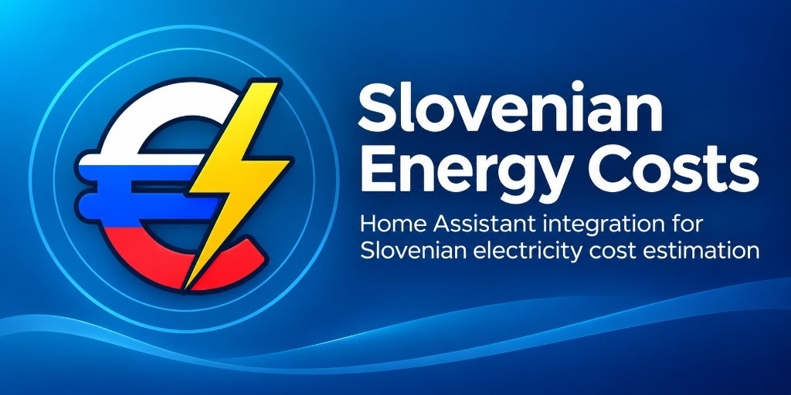

# Slovenian Energy Costs

Estimated Slovenian electricity costs for the native Home Assistant Energy dashboard.

This is a **pre-release**. Enable **Show beta versions** in HACS before installing.

## What it does

- Current €/kWh price and accumulated cost sensors for the Energy dashboard
- ET, VT/MT, and dynamic supplier prices
- Slovenian network charges (*omrežnina*), including Nov–Dec 2026 reduced power tariffs
- Optional Souporaba (`energy_sharing`) receiver savings and donor annual net metering

## Install

Add `https://github.com/gztproject/slovenian-energy-costs` in HACS as an **Integration**, then add **Slovenian Energy Costs** from Settings → Devices & services.

Configuration is done in the UI. No YAML is required.

## Important

Figures are **estimates**, not official invoices. Souporaba is optional and must be installed separately.

Minimum Home Assistant version: **2025.1.0**

[Documentation](https://github.com/gztproject/slovenian-energy-costs) · [Issues](https://github.com/gztproject/slovenian-energy-costs/issues) · [Releases](https://github.com/gztproject/slovenian-energy-costs/releases)
